# Hey, I'm HaoHao. 👋

前端開發 · 介面設計

[個人作品](#個人作品) &nbsp; / &nbsp; [經驗 Demo](#經驗-demo) &nbsp; / &nbsp; [技術與工具](#技術與工具)

## 個人作品

<a href="https://enjoy-luxury-hotel.onrender.com/"><picture><source media="(max-width: 767px)" srcset="assets/cards/enjoy-luxury-hotel-mobile.32aef4541a.svg" width="280"><source media="(min-width: 768px)" srcset="assets/cards/enjoy-luxury-hotel.bc9939f3dd.svg" width="410">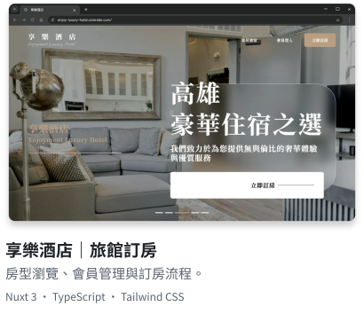</picture></a>
<a href="https://cutecat8110.github.io/metawall-front/"><picture><source media="(max-width: 767px)" srcset="assets/cards/metawall-front-mobile.de073892fd.svg" width="280"><source media="(min-width: 768px)" srcset="assets/cards/metawall-front.f9a9531376.svg" width="410">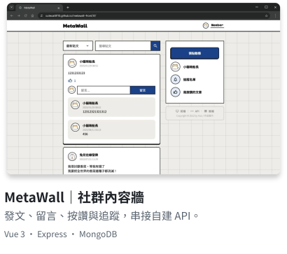</picture></a>
<a href="https://cutecat8110.github.io/snbl/"><picture><source media="(max-width: 767px)" srcset="assets/cards/snbl-mobile.3928f2c618.svg" width="280"><source media="(min-width: 768px)" srcset="assets/cards/snbl.7729376fef.svg" width="410">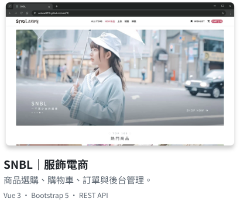</picture></a>
<a href="https://cutecat8110.github.io/ts-todo/#/login"><picture><source media="(max-width: 767px)" srcset="assets/cards/ts-todo-mobile.6ef80844ad.svg" width="280"><source media="(min-width: 768px)" srcset="assets/cards/ts-todo.dfab982275.svg" width="410">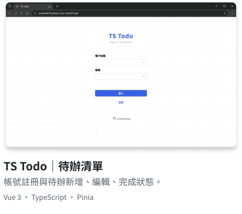</picture></a>
<a href="https://cutecat8110.github.io/maccha/"><picture><source media="(max-width: 767px)" srcset="assets/cards/maccha-mobile.93df29d1a5.svg" width="280"><source media="(min-width: 768px)" srcset="assets/cards/maccha.4c6c0b0cd4.svg" width="410">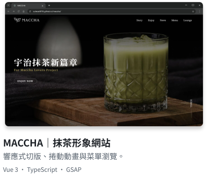</picture></a>
<a href="https://cutecat8110.github.io/leo-chiu/"><picture><source media="(max-width: 767px)" srcset="assets/cards/leo-chiu-mobile.c1645f0fc0.svg" width="280"><source media="(min-width: 768px)" srcset="assets/cards/leo-chiu.abfdb53a5c.svg" width="410">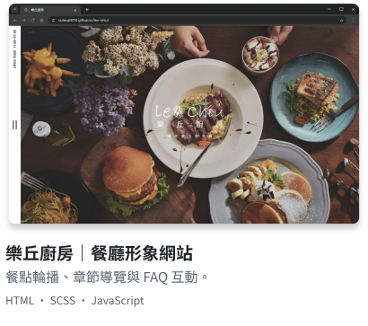</picture></a>

- [享樂酒店](#enjoy-luxury-hotel)　[Demo](https://enjoy-luxury-hotel.onrender.com/) · [專案介紹](https://github.com/cutecat8110/enjoy-luxury-hotel#readme)
- [MetaWall](#metawall-front)　[Demo](https://cutecat8110.github.io/metawall-front/) · [前端](https://github.com/cutecat8110/metawall-front#readme) · [後端](https://github.com/cutecat8110/metawall-back#readme)
- [SNBL](#snbl)　[Demo](https://cutecat8110.github.io/snbl/) · [專案介紹](https://github.com/cutecat8110/snbl#readme)
- [TS Todo](#ts-todo)　[Demo](https://cutecat8110.github.io/ts-todo/#/login) · [專案介紹](https://github.com/cutecat8110/ts-todo#readme)
- [MACCHA](#maccha)　[Demo](https://cutecat8110.github.io/maccha/) · [專案介紹](https://github.com/cutecat8110/maccha#readme)
- [樂丘廚房](#leo-chiu)　[Demo](https://cutecat8110.github.io/leo-chiu/) · [專案介紹](https://github.com/cutecat8110/leo-chiu#readme)

## 經驗 Demo

<a href="https://cutecat8110.github.io/islet-admin-demo/"><picture><source media="(max-width: 767px)" srcset="assets/cards/islet-admin-demo-mobile.2982ea026b.svg" width="280"><source media="(min-width: 768px)" srcset="assets/cards/islet-admin-demo.c2bf4e520e.svg" width="410">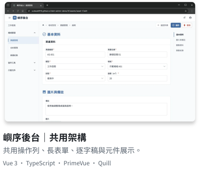</picture></a>
<a href="https://cutecat8110.github.io/weave-crm-demo/"><picture><source media="(max-width: 767px)" srcset="assets/cards/weave-crm-demo-mobile.01a9b4a50d.svg" width="280"><source media="(min-width: 768px)" srcset="assets/cards/weave-crm-demo.cd5ba7218b.svg" width="410">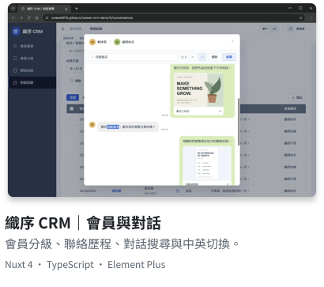</picture></a>
<a href="https://cutecat8110.github.io/tideline-energy-demo/"><picture><source media="(max-width: 767px)" srcset="assets/cards/tideline-energy-demo-mobile.61620fc3c8.svg" width="280"><source media="(min-width: 768px)" srcset="assets/cards/tideline-energy-demo.d6ef9047ff.svg" width="410">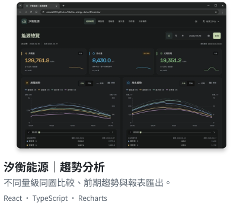</picture></a>
<a href="https://cutecat8110.github.io/stillroom-shop-demo/#/editor"><picture><source media="(max-width: 767px)" srcset="assets/cards/stillroom-shop-demo-mobile.f42094f303.svg" width="280"><source media="(min-width: 768px)" srcset="assets/cards/stillroom-shop-demo.dd2e2ecd82.svg" width="410">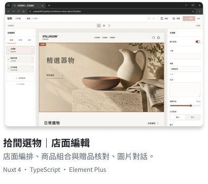</picture></a>
<a href="https://cutecat8110.github.io/unit-ledger-demo/"><picture><source media="(max-width: 767px)" srcset="assets/cards/unit-ledger-demo-mobile.2f2bef2a70.svg" width="280"><source media="(min-width: 768px)" srcset="assets/cards/unit-ledger-demo.4ab8731eb6.svg" width="410">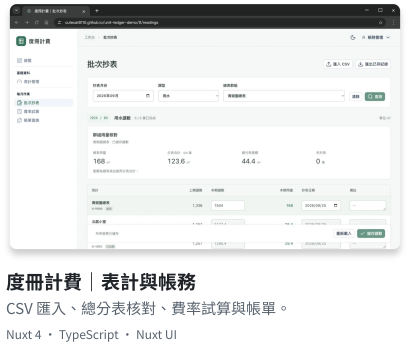</picture></a>

- [嶼序後台](#islet-admin-demo)　[Demo](https://cutecat8110.github.io/islet-admin-demo/) · [專案介紹](https://github.com/cutecat8110/islet-admin-demo#readme)
- [織序 CRM](#weave-crm-demo)　[Demo](https://cutecat8110.github.io/weave-crm-demo/) · [專案介紹](https://github.com/cutecat8110/weave-crm-demo#readme)
- [汐衡能源](#tideline-energy-demo)　[Demo](https://cutecat8110.github.io/tideline-energy-demo/) · [專案介紹](https://github.com/cutecat8110/tideline-energy-demo#readme)
- [拾間選物](#stillroom-shop-demo)　[編輯器](https://cutecat8110.github.io/stillroom-shop-demo/#/editor) · [店面](https://cutecat8110.github.io/stillroom-shop-demo/) · [專案介紹](https://github.com/cutecat8110/stillroom-shop-demo#readme)
- [度冊計費](#unit-ledger-demo)　[Demo](https://cutecat8110.github.io/unit-ledger-demo/) · [專案介紹](https://github.com/cutecat8110/unit-ledger-demo#readme)

## 技術與工具

    

    

  

   

    
