# Hey, I'm HaoHao. 👋

前端開發與介面設計，使用 Vue、Nuxt、React 與 TypeScript。

[個人作品](#個人作品) · [互動 Demo](#互動-demo) · [技術與工具](#技術與工具)

## 個人作品

<table>
<tr>
<td width="50%" valign="top">
<h3>享樂酒店｜旅館訂房</h3>
<a href="https://enjoy-luxury-hotel.onrender.com/">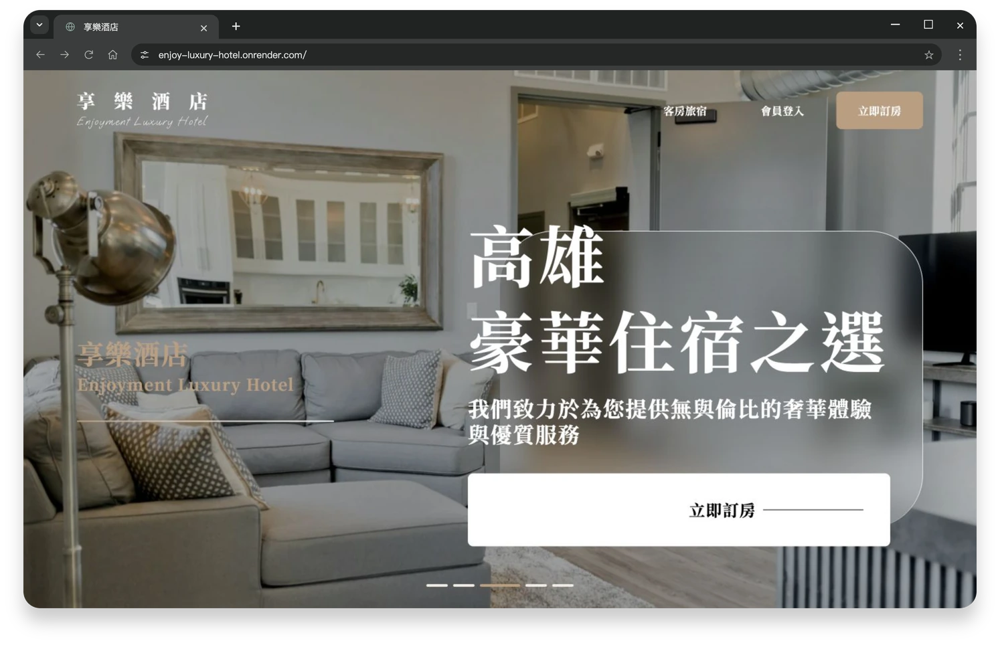</a>

房型瀏覽、會員管理與訂房流程。

Nuxt 3 · TypeScript · Tailwind CSS

<a href="https://enjoy-luxury-hotel.onrender.com/">Demo</a> · <a href="https://github.com/cutecat8110/enjoy-luxury-hotel#readme">專案介紹</a> <a href="https://enjoy-luxury-hotel.onrender.com/auth/login">會員登入</a>：點鑰匙帶入帳密，再按登入。

</td>
<td width="50%" valign="top">
<h3>MetaWall｜社群內容牆</h3>
<a href="https://cutecat8110.github.io/metawall-front/">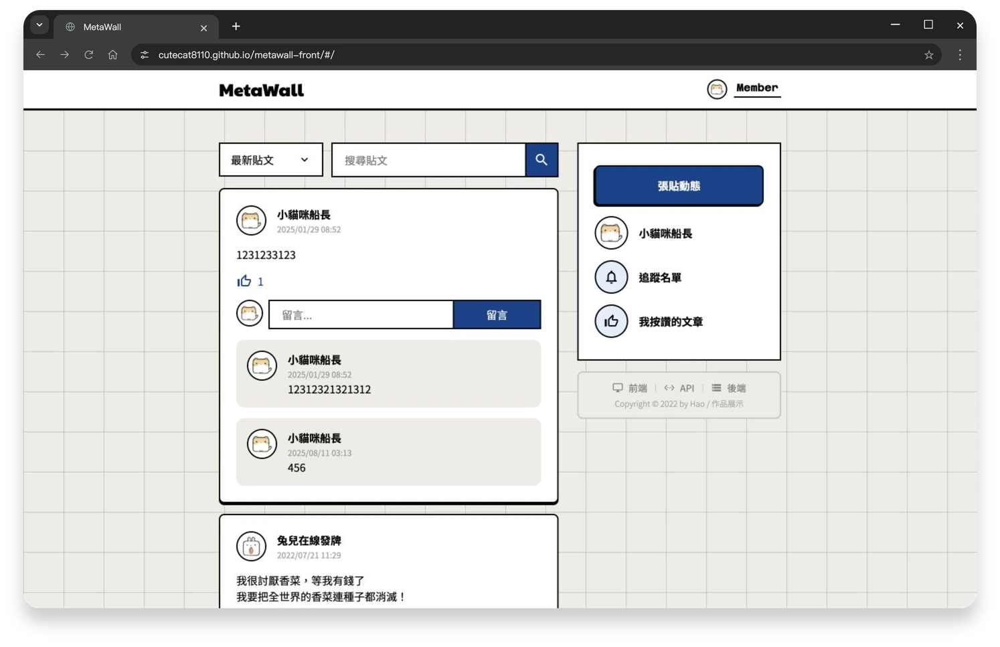</a>

發文、留言、按讚與追蹤，串接自建 API。

Vue 3 · Express · MongoDB

<a href="https://cutecat8110.github.io/metawall-front/">Demo</a> · <a href="https://github.com/cutecat8110/metawall-front#readme">前端</a> · <a href="https://github.com/cutecat8110/metawall-back#readme">後端</a> 點鑰匙帶入帳密，再按登入。

</td>
</tr>
<tr>
<td width="50%" valign="top">
<h3>SNBL｜服飾電商</h3>
<a href="https://cutecat8110.github.io/snbl/">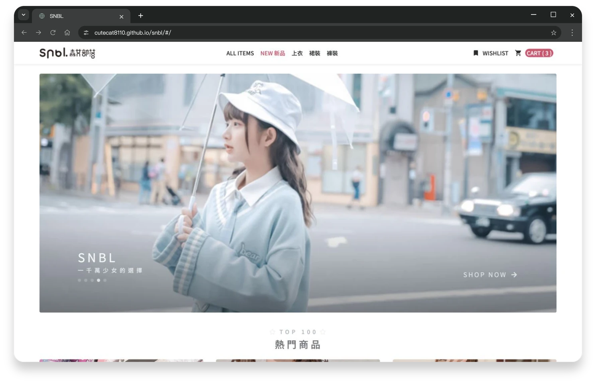</a>

商品選購、購物車、訂單與後台管理。

Vue 3 · Bootstrap 5 · REST API

<a href="https://cutecat8110.github.io/snbl/">Demo</a> · <a href="https://github.com/cutecat8110/snbl#readme">專案介紹</a> 前台可直接體驗；後台需管理帳號。

</td>
<td width="50%" valign="top">
<h3>TS Todo｜待辦清單</h3>
<a href="https://cutecat8110.github.io/ts-todo/#/login">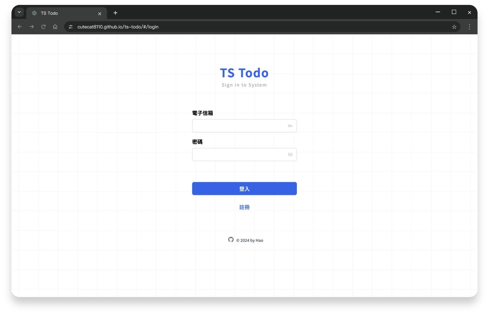</a>

帳號註冊與待辦新增、編輯、完成狀態。

Vue 3 · TypeScript · Pinia

<a href="https://cutecat8110.github.io/ts-todo/#/login">Demo</a> · <a href="https://github.com/cutecat8110/ts-todo#readme">專案介紹</a> 點鑰匙帶入帳密，再按登入。

</td>
</tr>
<tr>
<td width="50%" valign="top">
<h3>MACCHA｜抹茶形象網站</h3>
<a href="https://cutecat8110.github.io/maccha/">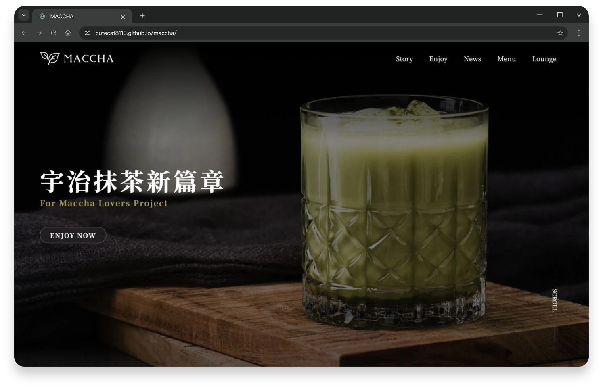</a>

響應式切版、捲動動畫與菜單瀏覽。

Vue 3 · TypeScript · GSAP

<a href="https://cutecat8110.github.io/maccha/">Demo</a> · <a href="https://github.com/cutecat8110/maccha#readme">專案介紹</a>

</td>
<td width="50%" valign="top">
<h3>樂丘廚房｜餐廳形象網站</h3>
<a href="https://cutecat8110.github.io/leo-chiu/">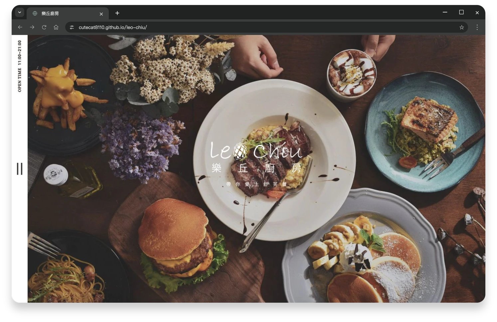</a>

餐點輪播、章節導覽與 FAQ 互動。

HTML · SCSS · JavaScript

<a href="https://cutecat8110.github.io/leo-chiu/">Demo</a> · <a href="https://github.com/cutecat8110/leo-chiu#readme">專案介紹</a>

</td>
</tr>
</table>

享樂酒店與 MetaWall 首次開啟可能需要等待服務啟動；共用展示帳號請勿填入個人資訊或更改密碼。

## 互動 Demo

<table>
<tr>
<td width="50%" valign="top">
<h3>嶼序後台｜共用架構</h3>
<a href="https://cutecat8110.github.io/islet-admin-demo/">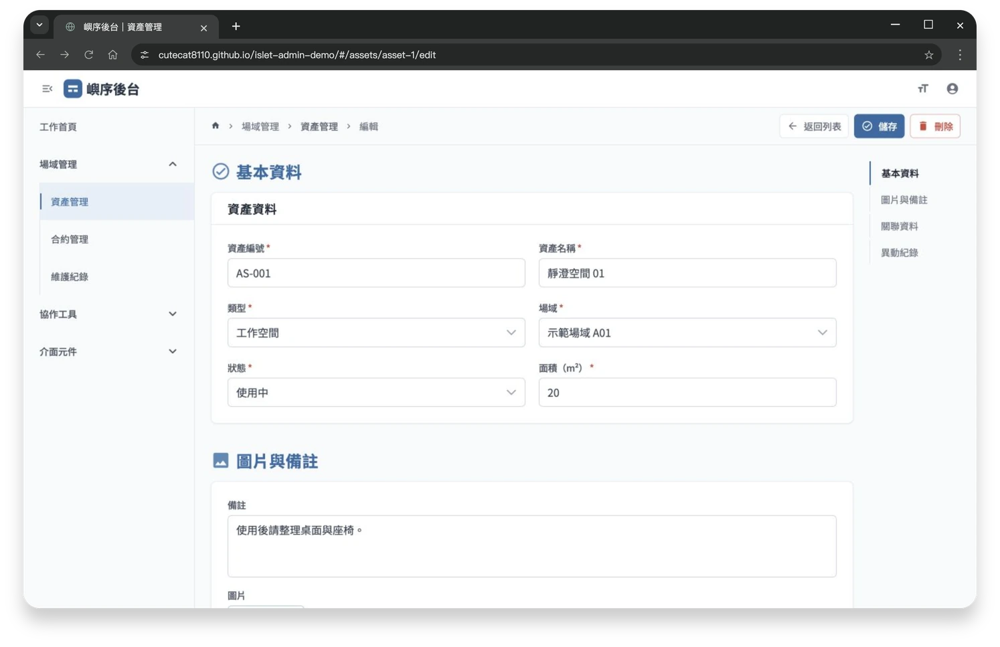</a>

共用操作列、長表單、逐字稿與元件展示。

Vue 3 · TypeScript · PrimeVue · Quill

<a href="https://cutecat8110.github.io/islet-admin-demo/">Demo</a> · <a href="https://github.com/cutecat8110/islet-admin-demo#readme">專案介紹</a>

</td>
<td width="50%" valign="top">
<h3>織序 CRM｜會員與對話</h3>
<a href="https://cutecat8110.github.io/weave-crm-demo/">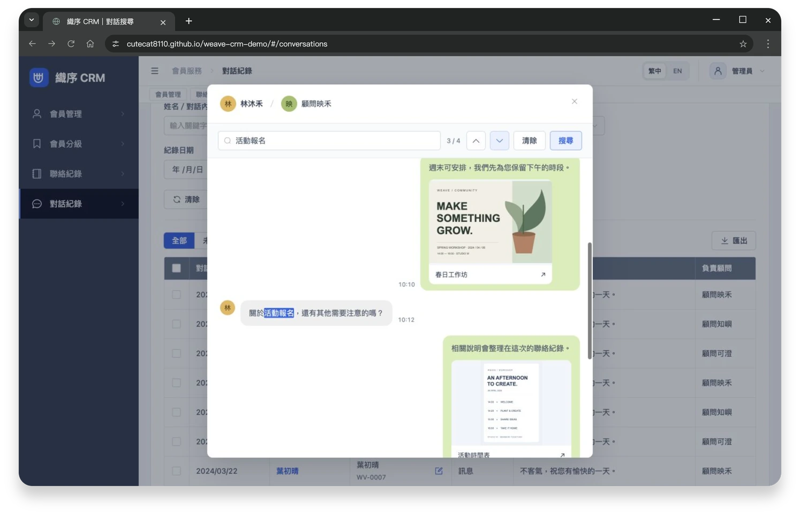</a>

會員分級、聯絡歷程、對話搜尋與中英切換。

Nuxt 4 · TypeScript · Element Plus

<a href="https://cutecat8110.github.io/weave-crm-demo/">Demo</a> · <a href="https://github.com/cutecat8110/weave-crm-demo#readme">專案介紹</a>

</td>
</tr>
<tr>
<td width="50%" valign="top">
<h3>汐衡能源｜趨勢分析</h3>
<a href="https://cutecat8110.github.io/tideline-energy-demo/">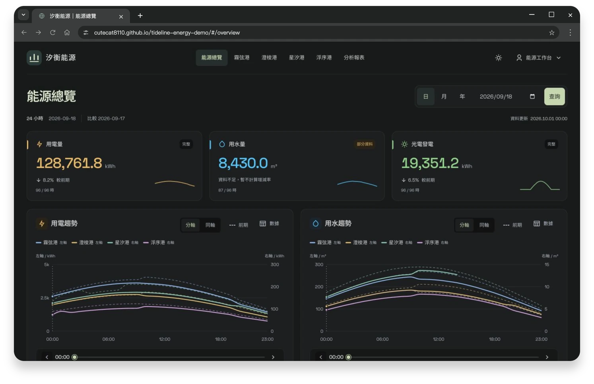</a>

不同量級同圖比較、前期趨勢與報表匯出。

React · TypeScript · Recharts

<a href="https://cutecat8110.github.io/tideline-energy-demo/">Demo</a> · <a href="https://github.com/cutecat8110/tideline-energy-demo#readme">專案介紹</a>

</td>
<td width="50%" valign="top">
<h3>拾間選物｜店面編輯</h3>
<a href="https://cutecat8110.github.io/stillroom-shop-demo/#/editor">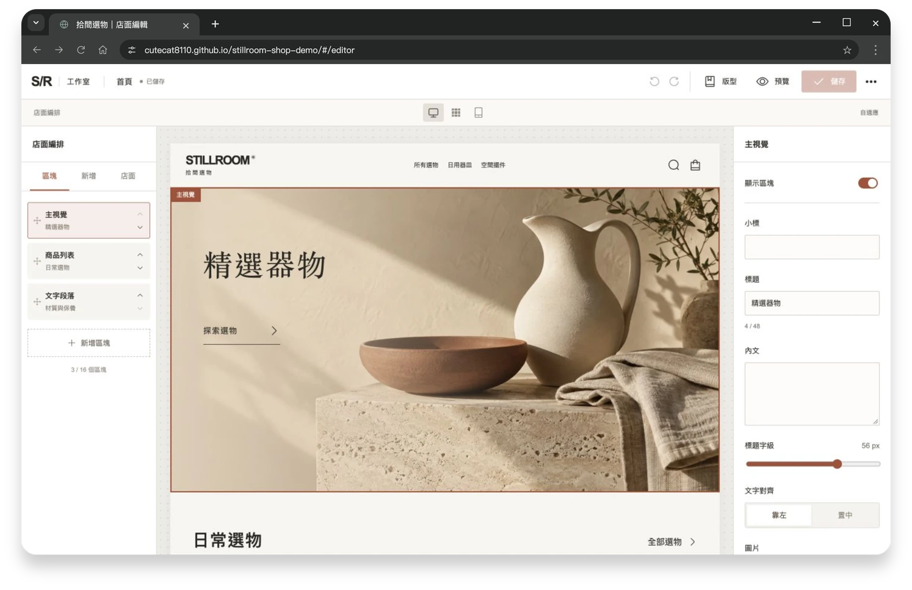</a>

店面編排、商品組合與贈品核對、圖片對話。

Nuxt 4 · TypeScript · Element Plus

<a href="https://cutecat8110.github.io/stillroom-shop-demo/#/editor">編輯器</a> · <a href="https://cutecat8110.github.io/stillroom-shop-demo/">店面</a> · <a href="https://github.com/cutecat8110/stillroom-shop-demo#readme">專案介紹</a>

</td>
</tr>
<tr>
<td width="50%" valign="top">
<h3>度冊計費｜表計與帳務</h3>
<a href="https://cutecat8110.github.io/unit-ledger-demo/">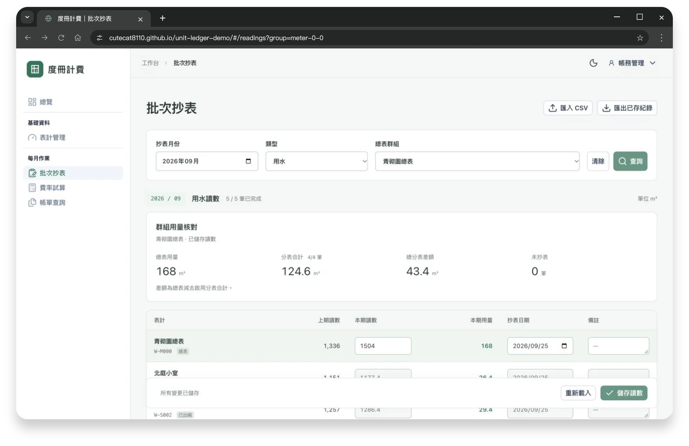</a>

CSV 匯入、總分表核對、費率試算與帳單。

Nuxt 4 · TypeScript · Nuxt UI

<a href="https://cutecat8110.github.io/unit-ledger-demo/">Demo</a> · <a href="https://github.com/cutecat8110/unit-ledger-demo#readme">專案介紹</a>

</td>
</tr>
</table>

五個 Demo 使用展示資料，操作保存在目前瀏覽器；角色與使用限制詳見各專案介紹。

## 技術與工具

**前端：** Vue · Nuxt · React · JavaScript · TypeScript 
**樣式：** HTML · CSS／SCSS · Tailwind CSS · Bootstrap 
**後端：** Node.js · Express · MongoDB 
**工具：** Git · Postman · Figma · Illustrator · Photoshop
